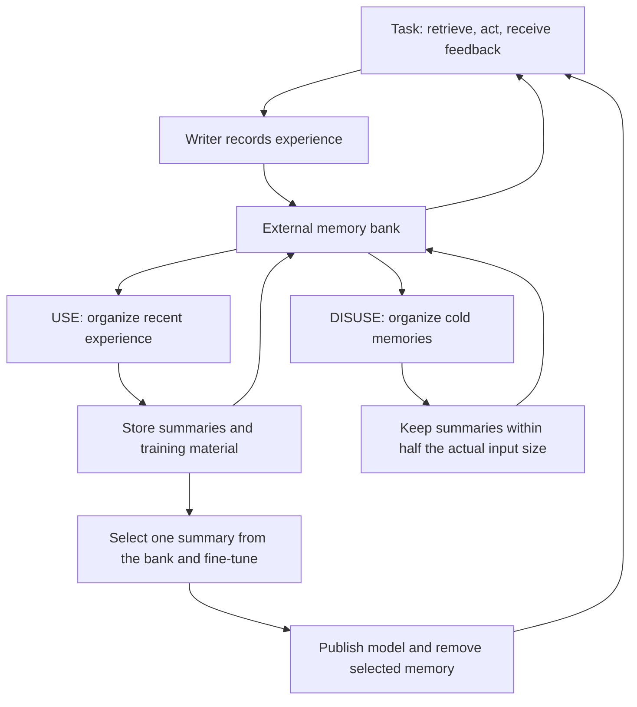

# Architecture

[English](architecture.md) | [简体中文](architecture.zh-CN.md)

MemTurn stores experience in two places: **external memory holds retrievable text, while the task model learns selected experience through fine-tuning.** USE organizes experience and trains the model; DISUSE compresses less-used memories. Together, they manage a limited space for accumulated experience.

## Start with one task

At task start, the runtime fixes the model version and memories available to that task. The agent retrieves relevant memories, chooses actions, and receives environment feedback. When the task ends, the Writer turns that experience into a memory with applicability conditions and source-step references.

The foreground continues handling tasks while the background organizes experience. After a model update, new tasks use the new version; tasks already in progress keep their original model and memory view.

## USE: turn experience into training material

Each USE cycle collects records awaiting consolidation and recently retrieved memories, fitting them within the input budget. This group of entries is called a *region*.

The Consolidator can inspect the region and its sources. It produces summaries with two kinds of training material: **rule questions and answers** describe the experience, and **decision demonstrations** supply observations and actions from source tasks. After source checks, the system writes the summaries and material back to the bank.

The system then selects one trainable summary from the entire bank. By default, it must cite at least two distinct tasks, contain one rule QA and at least one decision demonstration, and fit the entry and training budgets. Candidates are ranked by distinct source-task count, with seeded tie-breaking. Each cycle selects at most one; summaries retained from earlier cycles also participate.

The learner fine-tunes the current model and prepares the new version. The system then commits two changes together: publishing the model and removing the selected external memory. If training or preparation fails, the current model and target memory remain available; completed external consolidation stays in place.

## DISUSE: make room for new experience

DISUSE runs at a slower fixed cadence and focuses on external memory. Entries unused for at least one USE batch become candidates. The system scans them from coldest to warmest, adding entries within the input token budget and skipping entries that do not fit so it can consider later ones.

The same Consolidator produces compact summaries. The system favors summaries with broader source coverage and retains whole entries within **half the actual selected input**, also respecting the output cap. For example, an input of 1,000 tokens allows at most 500 output tokens. If no summary fits, the original region stays in place.

One DISUSE cycle can process several regions in sequence. The number of memories in a region depends on their lengths and the input budget.

## How the schedules fit together

By default, USE runs every 4 recorded task outcomes. DISUSE runs every 4 USE batches, or 16 outcomes. Successful, failed, and rejected outcomes all count. When both paths are due, USE runs first.

See [Development](development.md) for intervals, region sizes, and per-cycle limits; [Components](components.md) for data flow between modules; and [Sources and training material](provenance.md) for source checks and training inputs.
