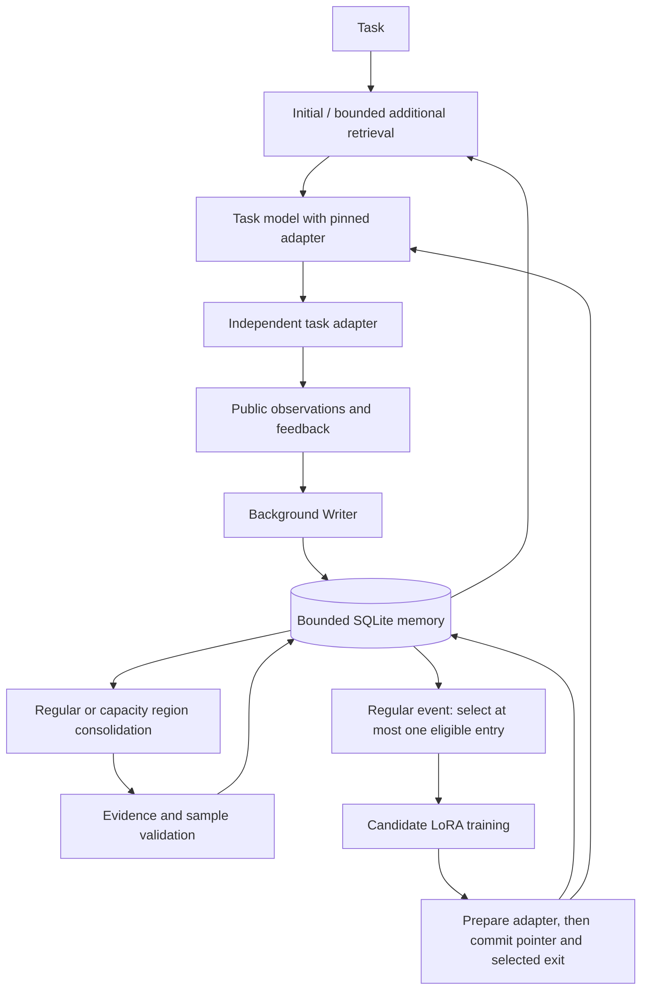

# Runtime architecture

The research objective is cumulative utility over a specified changing task
stream under explicit memory, parameter, learning and service budgets. No
component's presence establishes a performance advantage.

## Selection

An eligible entry is consolidated, within the entry-length budget, backed by at
least two different task instances, and has valid supervised examples. Support
counts are recomputed from currently available direct evidence; the same task
counts once. Highest count wins, with seeded random tie-breaking. No eligible
entry means no update. Unselected entries remain in external memory.

The selected entry, its parents and identified same-source aliases are excluded
from training retrieval. The language-model learner can receive remaining
retrieved memory. The tiny classifier uses only public observation features.
Independent semantic paraphrases are not automatically detected: this remains a
diagnostic obligation rather than a claimed perfect leakage detector.

## Capacity maintenance

The cold age is the foreground batch minus the last real task-access anchor.
Writing, inspecting, training or rewriting does not refresh that anchor. New
summaries inherit the latest anchor of their contributing parents.

Take the oldest initial fraction `m`, subject to a bounded input region. Generate
validated replacements, rank by distinct task support, and greedily retain whole
entries fitting at most half of the actual processed region's tokens. Oversized
entries are skipped. The resulting count `k` is measured, not configured. A
capacity event never trains the task model.

The trigger and target occupancy ratios leave headroom. A bounded number of
regions can be handled per event; unsuccessful compaction leaves the old region
intact. If admission still exceeds a limit, new experience is refused and that
event is recorded. No claim is made that every stream can be losslessly accepted.

## Publication and recovery

External consolidation commits first. Model publication is a later transaction,
after the candidate has been prepared for inference. Only the selected memory
version exits with the new model pointer. Training failure preserves the committed
external bank. Existing task leases retain their original model and memory view.

SQLite stores the current state and bounded job/results records. Pending writer
episodes can be requeued at startup. Writer insertion and its source-stage marker
commit together, so a restart after insertion does not run that Writer again.
Uncommitted training jobs are cancelled;
their candidates never become the active model merely because files exist.
Idempotency IDs are retained within the bounded result-history window; an
unlimited arbitrary-ID replay guarantee is not claimed.

## Accounting limits

The initial implementation limits serialized active text, evidence/sample data,
metadata, snapshots, queue length, simulator steps, model versions and database
pages. It does not prove a bound on process RSS, inference KV caches, remote
server caches or failed artifact directories. Those deployment-level resources
must be measured and constrained before the long-run experiments.

The default lexical counter and retriever are development implementations. Remote
profiles use the task tokenizer; retriever choice and revisions must be frozen
for matched-budget comparisons. Audits are not returned through memory tools.
