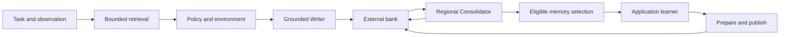

# Architecture

[English](architecture.md) | [简体中文](architecture.zh-CN.md)

The foreground executes tasks against pinned model and memory versions. The background writes, consolidates and learns. A task already in flight keeps its own view when later publications occur.

## Two maintenance paths

Regular batches default to four completed source tasks. The Consolidator reads a bounded region and its available source evidence, and emits a replacement set. Source verification and atomic replacement precede learning. At most one eligible entry with at least two distinct cited source tasks is selected. Default mixed supervision combines a rule QA with original source decisions; the learner must honor the selected material, exclusions and configured training limits.

A successful prepared artifact allows one transaction to change the published pointer and retire the selected entry version. A failed learning job preserves the committed external summaries. Retirement is not gated on a mastery test.

Consolidation samples are decoded and checked individually. Invalid samples are discarded without clearing valid neighbors; valid samples are retained in output order up to the shared count cap. A summary with an incomplete material mix remains external and is not eligible for mixed training. No extra retry or material-generation queue is introduced.

Cold-memory maintenance runs on its slower fixed schedule, regardless of bank occupancy. Entries unaccessed for at least one batch are scanned from coldest to warmest and packed whole within `region_token_cap` (default 4096). Non-fitting entries are skipped while later entries are still considered; there is no item-count fraction. Outputs are ranked by source coverage and packed whole within `min(floor(actual_input_tokens / 2), output_token_cap)`. The half budget is calculated from the actual selected region, not the configured input ceiling. This event never trains; an unusable replacement preserves the original region.

## Evidence and permissions

The policy reads retrieved memory; it does not directly write the bank. The Writer sees one public episode. The Consolidator may inspect the selected region and accessible sources. The built-in provenance checker validates source links, not the semantic correctness of summaries. Free-form summaries are allowed; semantic quality is evaluated separately. Hidden answers and evaluation metadata are not public experience.

Training excludes the target, its parents, same-source entries and recognized text copies from external-memory retrieval. Histories are rebuilt from original observation/action steps, without replaying historical retrieval messages. Text overlap with a memory does not invalidate native observations or actions. This controls the external-memory channel, not all possible answer clues. Read-only evaluation does not update memory access counters or restore pending learning jobs. Audit logs are analysis outputs, not a retrievable experience store.

Every training call receives `histories` and `memory_context` through the same learner contract. Empty context is represented by empty data, never by switching to a shorter call that drops history.

## Budgets and recovery

`Config`, `Store` and `Runtime` bound active memory, retained sources, queues, retrieval, supervision and version state. SQLite transactions protect replacement and publication. Recovery records retain pending writes, stream position and a bounded completion window. Finite queues and task deadlines support offered-load accounting.

Applications must still enforce deployment-wide RAM/GPU/storage limits and cancellation in their backends. The arrival driver is not a fixed-horizon evaluator; whole-run cutoff, parent-chain settlement, checkpoint branching and scientific evaluation remain separate integration work. No infinite deduplication or exactly-once external action guarantee is claimed.

See [component contracts](components.md) and [development](development.md).

The obsolete `cold_fraction` setting is removed; delete it from old configurations. The input token cap now directly bounds region selection.

## Maintenance schedule

`Config.batch_size` controls the regular use/internalization interval in accounted source-task outcomes (default 4). `Config.capacity_interval_batches` is an integer greater than 1 (default 4); cold-memory consolidation without internalization runs every `batch_size * capacity_interval_batches` outcomes (default 16). Successful, failed and rejected outcomes advance the existing completion counter; read-only probes do not. The same Consolidator is used, with no training on the cold path. Coincident schedules run regular maintenance first, then cold maintenance.

Each cold event processes up to `max_capacity_regions` regions (default 2), even below the memory limit. Empty/failed attempts wait for the next window. Busy workers coalesce overdue windows; persistent attempt markers prevent repeated claims on restart. A claimed attempt interrupted by a crash is not guaranteed to replay. The hard memory cap still rejects oversized writes, without triggering extra consolidation. Occupancy-based `capacity_trigger_ratio` and `capacity_target_ratio` are removed; old configurations must replace them with `capacity_interval_batches`. These are development defaults, not tuned research settings.
