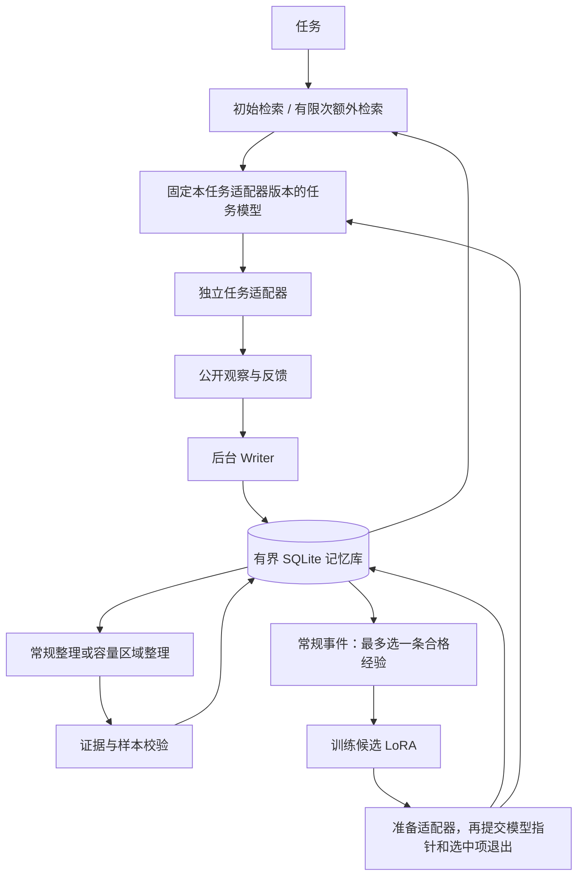

# 运行时架构

[English](architecture.md) | [简体中文](architecture.zh-CN.md)

研究目标是在明确的记忆、参数、学习和服务预算下，提高指定变化任务流的累计效用。某个组件已经存在，并不能证明它带来性能优势。

## 内化选择

合格条目须经过巩固、未超过长度预算、得到至少两个不同任务实例支持，并具有有效监督样本。支持数根据当前仍可获得的直接证据重新计算，同一任务只计一次。支持数最高者优先，并列按种子随机选择。没有合格条目就不更新，未选条目继续留在外部库。

训练检索排除选中条目、父条目及已识别的同源副本。语言模型学习器可以读取其余允许检索的记忆；微型分类器只使用公开观察特征。独立来源的语义改写不能自动全部识别，仍需诊断，不能宣称完美防止泄漏。

## 行动与训练约定

检索交互与环境证据步骤分开。任务模型能看到自动检索、后续查询及结果、错误和剩余调用次数。额度耗尽后的工具请求不会成为环境命令，每任务的决策上限仍约束循环。禁用记忆的评估同时移除初始检索和额外工具访问。

任务适配器可以公开适用范围。开发环境的任务族和版本对应不兼容规则，因此会精确过滤这些条件；没有此范围的环境仍使用词项匹配。这不是针对所有可迁移知识的通用过滤器。

当前训练配置将选中样本打乱后完整遍历一次，每样本更新一次，不自动增大梯度累积。显式设置 `steps` 的历史配置保留旧调度。无法在 token 和时限内完成规定遍历的作业被拒绝，并记录实际使用样本。当前样本保留原始来源状态和动作，不再自动投射来源状态。决策历史停在来源动作之前；历史检索正文和查询不复制进 SFT 输入，允许的其他记忆在静态训练前重新检索。

更新次数和样本覆盖率不证明掌握，当前发布策略没有通用的行为掌握门槛。

静态 SFT 在准备输入时检索允许的其他记忆，前向／反向计算中不执行模型新生成的工具调用。已有规则在新任务中得到证据时，Writer 仍可写入，不采用“只收新规则”的限制。任务内有界检索历史可以留在上下文，新结果不必替换专用槽位中的旧结果。

默认 `training_material: mixed` 要求一条与来源关联的规则问答和至少一条原生决策示范。问答以普通文本预测选中正文，决策以环境动作 JSON 为目标。每个样本绑定记忆版本和所覆盖的正文；两类材料在同一次巩固中产生，不新增教师或改写 Agent。每事件 32 条样本的预算包含问答，问答不会增加任务支持数。

有效外部记忆可以移除无效训练材料后保留。缺少材料时不会默默转为仅决策训练；微型分类器和历史诊断中的该模式均显式指定。

## 容量维护

冷年龄等于当前前台批次减去最近真实任务访问的锚点。写入、检查、训练或改写不刷新已有锚点；新摘要继承实际贡献父条目的最近锚点。

在输入区域上限内，初始选择最冷的比例 `m`。生成并校验替代条目，按不同任务支持数排序，逐条完整装入实际处理区域最多一半的 token 预算。过长条目跳过。最终保留数 `k` 是测量结果，不是预设数量；容量事件不训练任务模型。

触发和目标占用比例用于预留空间，每次事件只能处理有限个区域。整理失败保留旧区域；仍无法满足准入上限时拒绝新经验并记录。不保证任意任务流都能无损接纳。

## 发布与恢复

外部巩固先提交。候选模型准备好推理后，再通过另一次事务发布；只有选中记忆的对应版本随新模型指针退出。训练失败保留已提交外部库，在途任务继续持有原模型和记忆视图。

SQLite 保存当前状态及有界作业／结果记录。启动时可重新排队待写经历，Writer 插入与来源阶段标记共同提交，避免插入后重启再次运行 Writer。未提交的训练作业取消，候选不会仅因文件存在就自动成为当前模型。

正式远程入口还保存冻结任务清单、连续完成位置和有界乱序窗口，即使近期结果轮换也不会重计已完成的流位置。较早开发入口仅保留有限结果记录，不能把它等同于远程恢复协议。系统不承诺任意旧 ID 的无限重放去重，也不保证真实外部动作恰好执行一次。见[集群交接](cluster_handoff.zh-CN.md)。

## 资源核算的边界

当前实现限制活跃正文、来源／样本、元数据、快照、队列、模拟器步数、模型版本及数据库占用，并增加工作空间预留、训练进程内存监测、进程时限、持久计算额度和孤立候选归档。

这些软件控制不能证明整个部署的硬内存上限，推理缓存、远程服务缓存和峰值仍需测量并通过集群配额约束。详细实现和限制见[集群交接](cluster_handoff.zh-CN.md)。

默认词项计数器和检索器用于开发；远程配置使用任务 tokenizer。匹配预算比较需要固定检索器及相关版本。审计记录不通过记忆工具返回。

`stats.growth` 保存累计接纳 tokens、常规巩固净释放、内化退出释放、容量维护净释放，以及已有库的初始基线。计数与记忆变更在同一事务更新，用于分析增长；没有启用自适应调度器。
