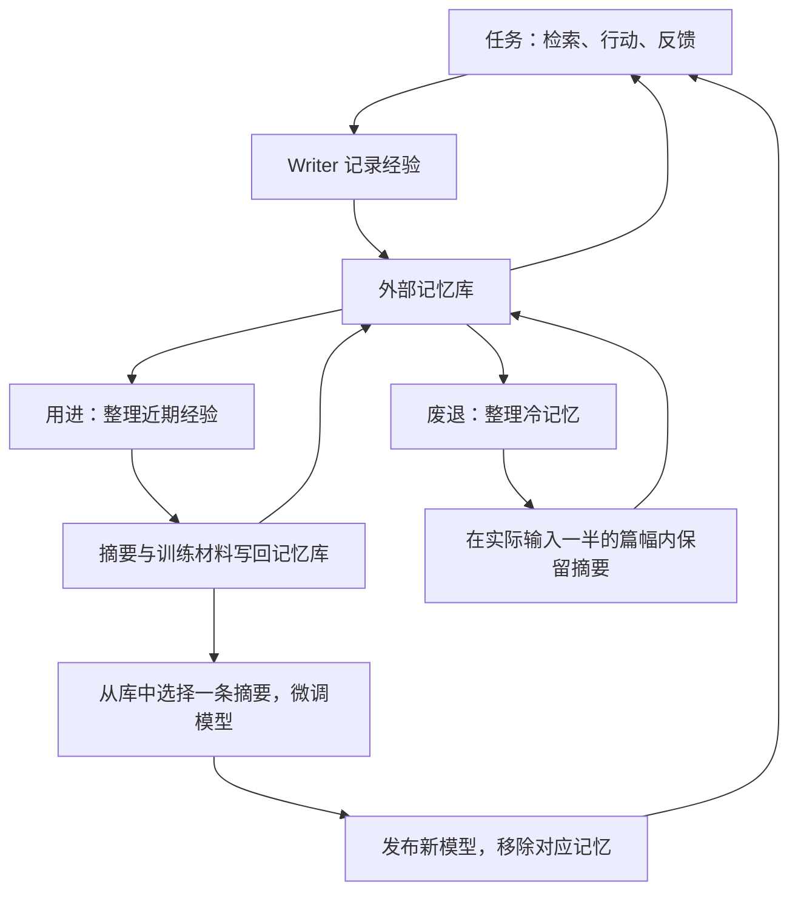

# 架构概况

[English](architecture.md) | [简体中文](architecture.zh-CN.md)

MemTurn 把经验放在两个地方：**外部记忆库保存可检索的文字，任务模型通过微调学习选中的经验。** 用进负责整理和学习，废退负责压缩较少使用的记忆。两者共同管理有限的经验存储空间。

## 先看一次任务

任务开始时，运行系统固定本次使用的模型版本和可读取的记忆内容。Agent 根据观察检索相关记忆，再选择动作并接收环境反馈。任务结束后，Writer 根据这次经历写出经验，附上适用条件和来源步骤。

前台继续处理任务，后台整理这些经验。后台发布新模型后，新任务使用新版本，已经开始的任务沿用原来的模型与记忆视图。

## 用进：把经验整理成可学习的内容

每到用进周期，系统收集尚未整理的记录和近期检索过的记忆，在输入预算内组成一个区域。这里的“区域”就是本次交给 Consolidator 的一组条目。

Consolidator 可查看这组记忆及其来源，输出若干摘要，并为每条摘要准备两类训练材料：**规则问答**描述经验内容，**决策示范**提供原任务中的观察和动作。系统完成来源检查后，将摘要和材料写回记忆库。

随后，系统从整个记忆库中选择一个可训练的摘要。默认要求它引用至少两个不同任务，包含至少一条有效规则问答和至少一条有效决策示范，并满足条目与训练预算。候选按不同来源任务的数量排序，每轮最多选一条，并列时按随机种子选择。此前保留的摘要也参加选择。

学习器在当前模型版本上微调，准备好新版本后，系统一起提交两项变化：发布新模型、移除选中的外部记忆。若训练或准备失败，当前模型和目标记忆继续保留；已经完成的外部经验整理仍然生效。

## 废退：给新经验腾出空间

废退按更慢的固定周期运行，专门整理外部记忆。至少一个用进批次未访问的条目成为候选；系统从最冷的开始，在输入 token 预算内依次装入，遇到装不下的条目就继续查看后面的条目。

同一个 Consolidator 生成更紧凑的摘要。系统优先保留来源覆盖较广的摘要，总篇幅最多为**实际选中输入的一半**，同时受输出上限约束。摘要按完整条目保留。例如，选中的输入合计 1,000 tokens，就最多保留 500 tokens；如果没有摘要能装下，原区域继续保留。

每轮废退可以依次整理多个区域。一个区域能装多少条记忆，取决于各条目的长度和输入预算。

## 两种节奏怎样配合

默认每累计 4 个任务结果执行一次用进，每经过 4 个用进批次执行一次废退，即每 16 个任务结果一次。成功、失败和拒绝都计入。同轮到期时先用进，再废退。

周期、区域大小和每轮整理次数均可配置，见[开发说明](development.zh-CN.md)。组件之间的数据传递见[组件与接口](components.zh-CN.md)，来源与训练输入的处理见[来源与训练材料](provenance.zh-CN.md)。
